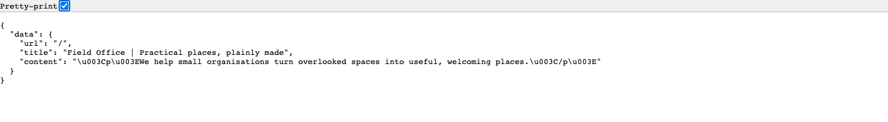
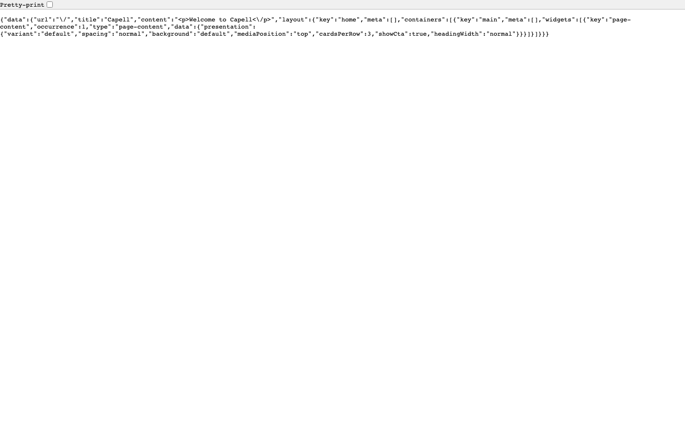

# API

<!-- prettier-ignore-start -->

## What It Does

API provides a supported v1 content API, typed TypeScript SDK and Next.js example, with cursor-paginated pages and collections, token-scoped previews and signed revalidation webhooks.

- **Price and availability:** Check current availability and price on the [Capell Marketplace listing](https://capell.app/extensions/api).
- **Licence:** Check the licence terms on the [Capell Marketplace listing](https://capell.app/extensions/api).
- **Requires:** `PHP ^8.4`, `capell-app/core ^1.0.76`, `capell-app/layout-builder ^1.0`, `laravel/sanctum ^4.0`, `spatie/laravel-package-tools ^1.14.1`, `symfony/html-sanitizer ^7.0|^8.0`.
- **Install:** `composer require capell-app/api`.

Headless clients can read published pages, filter collections, search titles and load a page directory and content images. Preview tokens remain on the server. There is no editing endpoint.

## Who It Is For

**For developers:** ResolveApiRequestContextAction, BuildPublicPagePayloadAction, and BuildPublicLayoutPayloadAction keep request resolution, sanitization, and layout bounds outside the controller.

**For teams:** A separate frontend can consume published Capell content without receiving draft, admin, or authoring state.

## Quick Start

1. Install the package: `composer require capell-app/api`.
2. Run `php artisan route:list` and verify the package routes are registered.

## Configure

- **Configuration files:** `config/capell-api.php`.

## Limits And Pitfalls

- Install the required Capell packages at the versions in `composer.json`: `capell-app/core ^1.0.76`, `capell-app/layout-builder ^1.0`.
- Review middleware, throttling, signatures, and public-output safety in `routes/api.php` before exposing routes.
- Keep public Blade and cached HTML free of authoring markers, model IDs, permissions, signed editor URLs, and lazy database queries.
- Custom write integrations must preserve invalidation for `api`, `api:pages` cache tags.

## Screens And Workflow

- JSON response returned for a published page (frontend).
- JSON response describing a page layout and the areas it contains (frontend).
- Page resolve forbidden JSON response (frontend).
- Page resolve not found JSON response (frontend).

## Install Impact

- Required packages: `capell-app/core`, `capell-app/layout-builder`.
- Admin navigation: no admin page or resource contribution is declared.
- Admin/editor extensions: none declared.
- Permissions: no package permission declarations or Shield gates detected; host access rules still apply.
- Public routes: loads `routes/api.php`; registers `ApiRoutesContribution`.
- Database changes: no package migrations declared.
- Config: `config/capell-api.php`.
- Settings: no package settings declared.
- Queues or schedules: queue jobs `DeliverRevalidationWebhookJob`.
- Cache tags: `api`, `api:pages`.
- Commands: none declared.

## Troubleshooting

| Symptom | Likely cause | Check | Fix |
| --- | --- | --- | --- |
| Package surface is missing after install | Provider or manifest is not loaded | Confirm `capell.json`, package `composer.json`, and provider registration | Reinstall the package, refresh Composer autoload, and clear host caches |
| Route returns unexpected output | Route cache, middleware, or signed URL setup does not match the package route file | Check the route files listed in `Technical Shape` | Clear route cache and verify middleware before exposing public routes |
| Background work does not run | Queue worker or declared schedule is not active | Check the jobs and scheduled commands listed in `Technical Shape` | Start the queue worker or host scheduler, then run the focused command or package test |
| Public output leaks unexpected state | Render data, cache variation, or authoring boundary has regressed | Check public Blade, cache tags, and public-output safety tests | Move data loading out of Blade and rerun the package public-output tests |

## Upgrading

No manual steps between minor versions.

Read [CHANGELOG.md](CHANGELOG.md) before upgrading.

## Next Steps

- [Package docs](docs/README.md)
- [Overview](docs/overview.md)
- Configuration files: [`config/capell-api.php`](config/capell-api.php).
- [Troubleshooting](#troubleshooting)
- [Developer reference](docs/reference.md)
- [Marketplace assets](docs/assets/marketplace/)
- [Capell content language plan](../../docs/CONTENT_LANGUAGE_PLAN.md)
- [Capell documentation design system](../../docs/DESIGN_SYSTEM.md)
- [Capell and package ERD notes](../../docs/erd/capell-and-package-erds.md)
- Related packages: [Layout Builder](../layout-builder/README.md).

<!-- prettier-ignore-end -->
