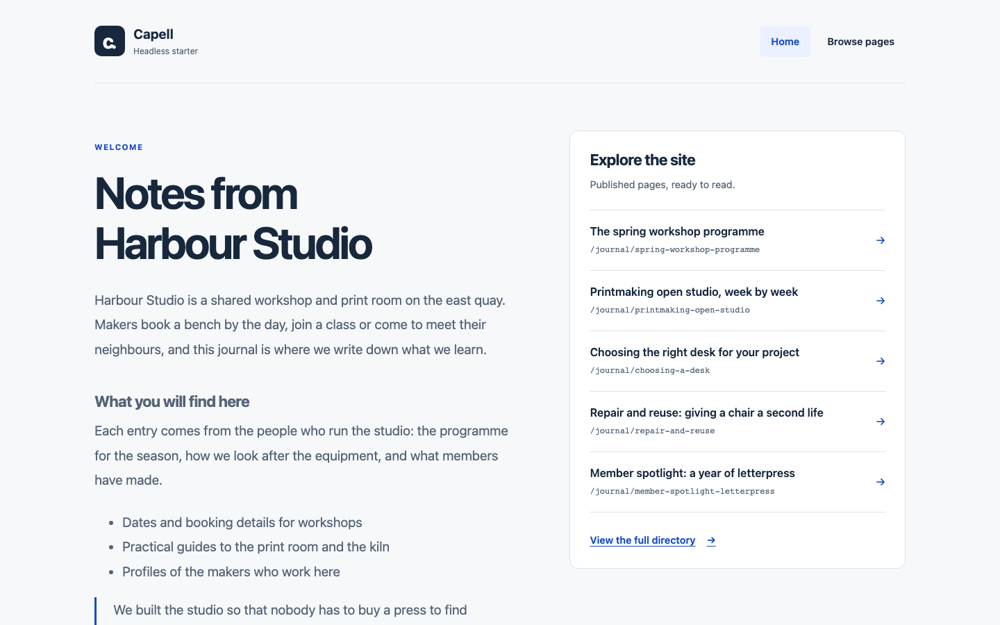
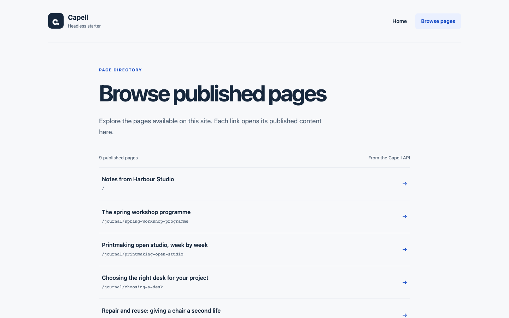

# API

<!-- prettier-ignore-start -->

You can show your published Capell pages on a separate website or mobile app, such as one built with Next.js or Nuxt. Your editors keep working in Capell as they do now.

Your developer can ask for one page by its address, list pages by type, search page titles or fetch a directory of pages. Lists arrive twenty at a time by default, up to a hundred, and each list points to the next batch if there is one. Pages that are live today are the only ones returned, and their content is cleaned of anything unsafe on the way out. The access is read-only and adds no admin screen. Drafts stay private unless your developer uses a personal key made for previewing.

When an editor publishes, saves or deletes a page, or a page's dates pass, Capell can send your front end a signed message. Sending starts once your developer has added the front end's address and a secret, and the messages go out as background jobs, which your developer or host keeps running. Each message names the site and page that changed.

- **Price and availability:** Check current availability and price on the [Capell Marketplace listing](https://capell.app/marketplace/extensions/api).
- **Licence:** Check the licence terms on the [Capell Marketplace listing](https://capell.app/marketplace/extensions/api).
- **Requires:** `PHP ^8.4`, `capell-app/core ^1.0.76`, `capell-app/layout-builder ^1.0`, `laravel/sanctum ^4.0`, `spatie/laravel-package-tools ^1.14.1`, `symfony/html-sanitizer ^7.0|^8.0`.
- **Install:** `composer require capell-app/api`.

## Quick Start

1. Install the package: `composer require capell-app/api`.
2. Run `php artisan route:list` and verify the package routes are registered.

## For Developers

ResolveApiRequestContextAction, BuildPublicPagePayloadAction, and BuildPublicLayoutPayloadAction keep request resolution, sanitization, and layout bounds outside the controller.

## Configure

- **Configuration files:** `config/capell-api.php`.

## Limits And Pitfalls

- Install the required Capell packages at the versions in `composer.json`: `capell-app/core ^1.0.76`, `capell-app/layout-builder ^1.0`.
- Review middleware, throttling, signatures, and public-output safety in `routes/api.php` before exposing routes.
- Keep public Blade and cached HTML free of authoring markers, model IDs, permissions, signed editor URLs, and lazy database queries.
- Custom write integrations must preserve invalidation for `api` cache tags.

## Screens And Workflow

- Studio journal home page rendered by the Next.js starter (frontend).
- Page directory rendered by the Next.js starter (frontend).
- Published article rendered by the Next.js starter (frontend).
- JSON response returned for a published page (frontend).
- JSON response describing a page layout and the areas it contains (frontend).
- Page resolve forbidden JSON response (frontend).
- Page resolve not found JSON response (frontend).

## Install Impact

- Required packages: `capell-app/core`, `capell-app/layout-builder`.
- Admin navigation: no admin page or resource contribution is declared.
- Admin/editor extensions: none declared.
- Permissions: no package permission declarations or Shield gates detected; host access rules still apply.
- Public routes: loads `routes/api.php`; registers `ApiRoutesContribution`.
- Database changes: no package migrations declared.
- Config: `config/capell-api.php`.
- Settings: no package settings declared.
- Queues or schedules: queue jobs `DeliverRevalidationWebhookJob`.
- Cache tags: `api`.
- Commands: none declared.

## Troubleshooting

| Symptom | Likely cause | Check | Fix |
| --- | --- | --- | --- |
| Package surface is missing after install | Provider or manifest is not loaded | Confirm `capell.json`, package `composer.json`, and provider registration | Reinstall the package, refresh Composer autoload, and clear host caches |
| Route returns unexpected output | Route cache, middleware, or signed URL setup does not match the package route file | Check the route files listed in `Technical Shape` | Clear route cache and verify middleware before exposing public routes |
| Background work does not run | Queue worker or declared schedule is not active | Check the jobs and scheduled commands listed in `Technical Shape` | Start the queue worker or host scheduler, then run the focused command or package test |
| Public output leaks unexpected state | Render data, cache variation, or authoring boundary has regressed | Check public Blade, cache tags, and public-output safety tests | Move data loading out of Blade and rerun the package public-output tests |

## Upgrading

No manual steps between minor versions.

Read [CHANGELOG.md](CHANGELOG.md) before upgrading.

## Next Steps

- [Package docs](docs/README.md)
- [Overview](docs/overview.md)
- Configuration files: [`config/capell-api.php`](config/capell-api.php).
- [Troubleshooting](#troubleshooting)
- [Developer reference](docs/reference.md)
- [Marketplace assets](docs/assets/marketplace/)
- [Capell content language plan](../../docs/CONTENT_LANGUAGE_PLAN.md)
- [Capell documentation design system](../../docs/DESIGN_SYSTEM.md)
- [Capell and package ERD notes](../../docs/erd/capell-and-package-erds.md)
- Related packages: [Layout Builder](../layout-builder/README.md).

<!-- prettier-ignore-end -->
