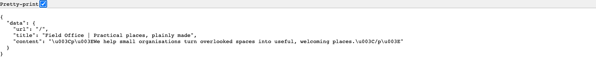
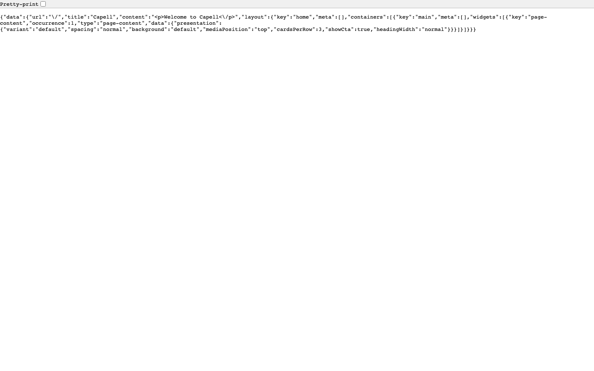

# API

<!-- prettier-ignore-start -->

## What This Plugin Adds

API is an **Available**, **No schema impact** Capell package in the **Capell Publishing** product group. It ships as `capell-app/api` and extends these surfaces: frontend.

API adds versioned public JSON endpoints for resolving published Capell pages and bounded Layout Builder graphs.

The package adds no admin screen. Headless clients can resolve a published page and request its sanitized public layout payload through the documented API routes.

Status details:

- Status: Available
- Tier: free
- Bundle: publishing
- Composer package: `capell-app/api`
- Namespace: `Capell\Api`
- Theme key: not applicable

## Why It Matters

**For developers:** ResolveApiRequestContextAction, BuildPublicPagePayloadAction, and BuildPublicLayoutPayloadAction keep request resolution, sanitization, and layout bounds outside the controller.

**For teams:** A separate frontend can consume published Capell content without receiving draft, admin, or authoring state.

## Screens And Workflow

Screenshot contract: `docs/screenshots.json`.

- Illustrative successful page resolve json response preview (frontend, required evidence).
- Page resolve layout graph JSON response (frontend, required evidence).
- Page resolve forbidden JSON response (frontend, supplementary evidence).
- Page resolve not found JSON response (frontend, supplementary evidence).

## Technical Shape

### Service providers

- `Capell\Api\Providers\ApiServiceProvider`

### Config files

- `packages/api/config/capell-api.php`

### Route files

- `packages/api/routes/api.php`

### Actions

- `BuildPublicLayoutPayloadAction`
- `BuildPublicPagePayloadAction`
- `ResolveApiRequestContextAction`
- `ValidatePublicLayoutPayloadBoundsAction`

### Data objects

- `PublicPagePayloadOptionsData`
- `ResolveApiRequestContextData`

### Manifest contributions

- `health-check: Capell\Api\Health\ApiHealthCheck`
- `route: Capell\Api\Manifest\ApiRoutesContribution`

### Health checks

- `Capell\Api\Health\ApiHealthCheck`

### Cache tags

- `api`
- `api:pages`

## Data Model

This package has no schema impact. It extends Capell through `health-check` contributions and `route` contributions instead of declaring package-owned tables.

## Install Impact

- Required packages: `capell-app/core`, `capell-app/layout-builder`.
- Admin navigation: no admin page or resource contribution is declared.
- Admin/editor extensions: none declared.
- Permissions: no package permission declarations or Shield gates detected; host access rules still apply.
- Public routes: loads `routes/api.php`; registers `ApiRoutesContribution`.
- Database changes: no package migrations declared.
- Config: `config/capell-api.php`.
- Settings: no package settings declared.
- Queues or schedules: none declared.
- Cache tags: `api`, `api:pages`.
- Commands: none declared.

## Common Pitfalls

- Keep required Capell packages on compatible v4 releases: `capell-app/core`, `capell-app/layout-builder`.
- Review package configuration before production-like verification: `config/capell-api.php`.
- Review middleware, throttling, signatures, and public-output safety in `routes/api.php` before exposing routes.
- Keep public Blade and cached HTML free of authoring markers, model IDs, permissions, signed editor URLs, and lazy database queries.
- Custom write integrations must preserve invalidation for `api`, `api:pages` cache tags.

## Troubleshooting

| Symptom | Likely cause | Check | Fix |
| --- | --- | --- | --- |
| Package surface is missing after install | Provider or manifest is not loaded | Confirm `capell.json`, package `composer.json`, and provider registration | Reinstall the package, refresh Composer autoload, and clear host caches |
| Route returns unexpected output | Route cache, middleware, or signed URL setup does not match the package route file | Check the route files listed in `Technical Shape` | Clear route cache and verify middleware before exposing public routes |
| Public output leaks unexpected state | Render data, cache variation, or authoring boundary has regressed | Check public Blade, cache tags, and public-output safety tests | Move data loading out of Blade and rerun the package public-output tests |

## Quick Start

1. Install the package: `composer require capell-app/api`.
2. Open `/api/capell/v1/pages/resolve?url=/&include=layout&containers=main` and confirm the public output renders without admin state.

## Next Steps

- [Package docs](docs/README.md)
- [Overview](docs/overview.md)
- Configuration files: [`config/capell-api.php`](config/capell-api.php).
- [Troubleshooting](#troubleshooting)
- [Screenshot contract](docs/screenshots.json)
- [Marketplace assets](docs/assets/marketplace/)
- [Capell content language plan](../../docs/CONTENT_LANGUAGE_PLAN.md)
- [Capell documentation design system](../../docs/DESIGN_SYSTEM.md)
- [Capell and package ERD notes](../../docs/erd/capell-and-package-erds.md)
- Related packages: [Layout Builder](../layout-builder/README.md).

<!-- prettier-ignore-end -->
